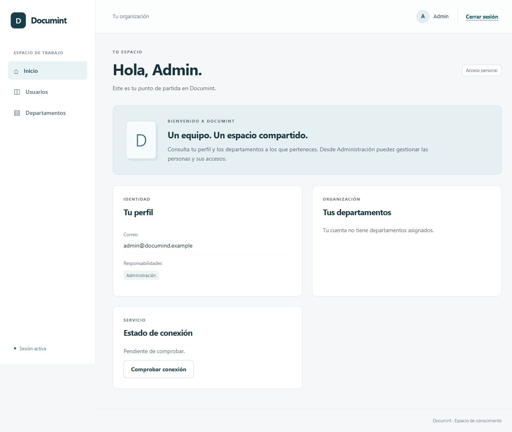
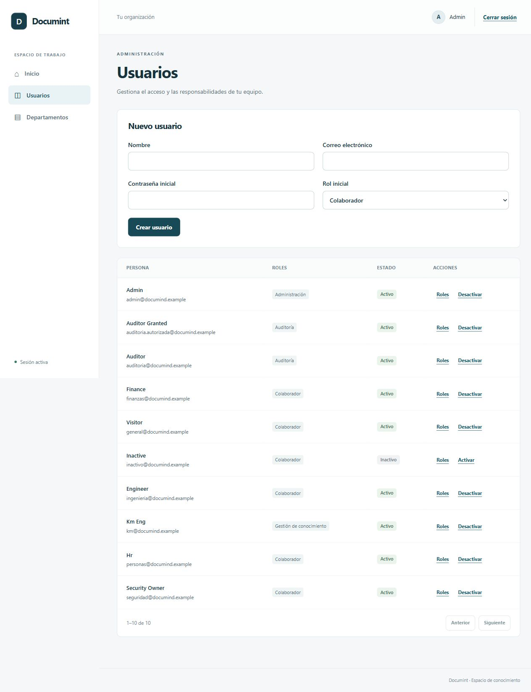
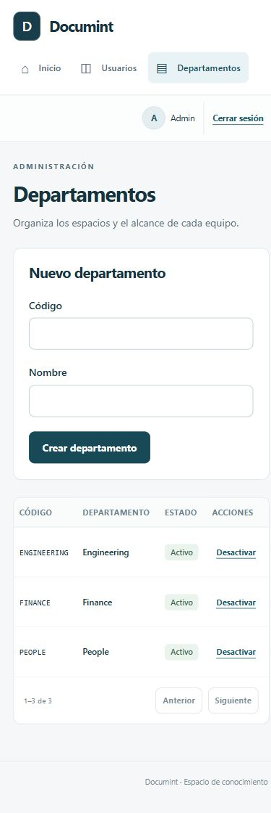

# Sesión 1C Interfaz autenticada y administración

## Entregable

Documint incorpora login, recuperación de sesión al recargar, navegación protegida y cierre de
sesión. El access JWT permanece en memoria; el navegador administra el refresh HttpOnly.
Un refresh compartido evita carreras dentro de la pestaña y Web Locks serializa las operaciones
de cookie entre pestañas cuando el navegador lo soporta. Cada respuesta se valida con Zod.

Las capabilities de `/me` controlan navegación y rutas. ADMIN dispone de usuarios paginados,
creación, cambios de estado y edición de roles; también de departamentos, creación y estado.
Los errores de autorización actualizan el perfil y se muestran sin revelar detalles internos.
Los permisos siguen comprobándose en el backend; ocultar un enlace no concede seguridad.

Vite utiliza `/api/*` y reescritura del path de la cookie. Así, recargar una ruta como
`/admin/departments` entrega React y permite recuperar la sesión. La interfaz usa etiquetas,
autocomplete, mensajes asociados, encabezados de tablas y foco visible; las rutas y el editor
de roles reciben foco al abrirse. El diseño se adapta a escritorio y móvil.

## Evidencia

Verificado el 15 de octubre de 2026:

- Lint, tipos TypeScript y build de producción: PASS.
- **13 pruebas web PASS**: cuatro de salud, cinco del cliente HTTP y cuatro de flujos de auth.
  Incluyen refresh concurrente, fallo de revocación, perfil inválido, recuperación bajo StrictMode,
  login rechazado, rutas protegidas y coordinación de cookie mediante Web Locks.
- Estas pruebas usan transporte HTTP simulado; no son evaluaciones de embeddings ni LLM.
- Navegador real contra API y PostgreSQL locales: login ADMIN, tablas reales, recuperación al
  recargar Inicio y `/admin/departments`, logout y rechazo de cuenta inactiva: PASS.
- Colaborador: administración ausente y acceso directo a `/admin/users` bloqueado: PASS.
- Dos pestañas recargadas concurrentemente conservaron la sesión del colaborador: PASS.
- Revisión visual a 1280 × 900 y 390 × 844; sin desbordamiento de página. Las tablas extensas
  disponen de desplazamiento propio. El editor de roles recibe foco sin modificar permisos.
- Backend sin cambios desde 1B: 69 pruebas Python con servicios reales y CI de 1B en verde.

Capturas del navegador real:

## Límites

Todavía no existen biblioteca, búsqueda ni chat. El alcance administrativo de esta sesión no
incluye una pantalla de edición de memberships; sus endpoints ya existen en 1B. No se declara
una auditoría formal WCAG ni compatibilidad entre pestañas en navegadores sin Web Locks.
Los controles de abuso y el proxy/cookie HTTPS de producción se cierran en las fases 7 y 8.
La revisión ofensiva de identidad y permisos corresponde a la siguiente sesión 1R.
