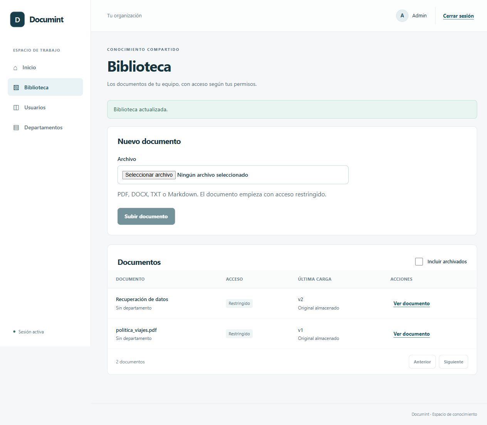
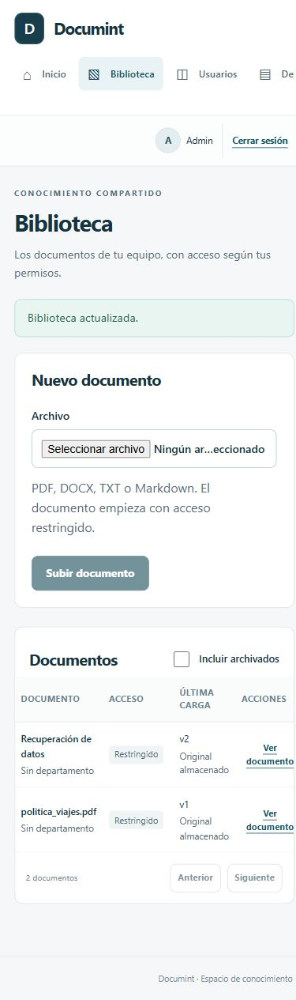

# Sesión 2B Biblioteca, versiones y permisos persistidos

## Entregable

Migración 0005 con archivo lógico de documentos y grants READ/MANAGE para un único usuario o
rol, FK, constraints y unicidad. COMPANY, DEPARTMENT y RESTRICTED se aplican desde predicados
SQL reutilizables antes de conteo, orden y paginación. Owner/ADMIN/grants y KM dentro de su
alcance siguen [ADR 0002](../adr/0002-access.md), incluida la restricción del auditor.

La API incorpora biblioteca y detalle, edición de metadata/visibilidad, versiones paginadas,
nueva versión, grants paginados y descarga autenticada. Cada nueva versión conserva número,
hash, bytes y key de las anteriores. Un lock de documento serializa la reserva del número.
Archivar oculta de la lista predeterminada, preservando originales para lectura autorizada.
Cada descarga revalida READ, verifica hash/tamaño y usa attachment + nosniff + no-store.

La web añade Biblioteca, carga, detalle, edición de metadata/visibilidad, archivo/restauración,
versiones y descarga. Solo ofrece acciones de gestión según `can_manage`. Los grants específicos
se administran mediante API en esta sesión; su editor visual queda para administración en fase 6.

## Evidencia

Verificado el 16 de octubre de 2026:

- Migración 0005 aplicada; `alembic check` sin diferencias.
- Suite completa: **115 pruebas Python PASS** con PostgreSQL, Redis y MinIO reales; **17 pruebas
  web PASS**; Ruff, formato, mypy estricto (65 archivos), lint/tipos/build web: PASS.
- Predicado SQL contrastado con las 80 decisiones de las diez personas/ocho documentos.
  La API pagina sin revelar conteos ajenos; los IDs inaccesibles no consultan storage.
  Esta matriz usa storage de corpus explícitamente en memoria y PostgreSQL real. Los trece
  casos de uploads/versiones utilizan MinIO real y limpian solo sus keys de prueba.
- Grants READ no permiten escribir; MANAGE habilita nueva versión. Revocar retira lectura
  con el mismo token. El original v1 conserva bytes después de subir v2.
- Archivo lógico conserva lectura autorizada; revocación del grant oculta también el original
  archivado. Un departamento inactivo pierde alcance implícito, preservando derechos del owner.
- Navegador real: upload DOCX sintético, edición de título y carga de v2: PASS. Descarga v1
  comprobada con SHA-256 `05864b6872f8fddcc06056e43eb727baee0fa5a89d7fc3f59ebcad73a1902844`.
- Revisión visual a 1280 × 900 y 390 × 844. Se corrigió el ancho mínimo del grid móvil;
  página sin desbordamiento horizontal, navegación con desplazamiento propio.
- Las pruebas React usan HTTP simulado. Para el FileList simulado de userEvent, jsdom mantiene
  vacía su lista interna de validación required; esas pruebas envían el evento de formulario.
  Selección y submit nativos se comprobaron aparte en el navegador real, sin quitar required.

El detalle de las dos versiones está en [esta captura](../screenshots/2B-versions-desktop.png).

## Límites

La biblioteca todavía no incluye búsqueda ni chat; UPLOADED solo significa original almacenado.
La revisión activa de índice llegará con el pipeline en fase 3, conservando evidencia anterior.
La pantalla de departamento ofrece hasta 100 opciones por consulta; la paginación administrativa
completa de ese selector se revisará con los volúmenes de fase 7. Los jobs llegan en 2C y la
revisión de concurrencia y fallos asíncronos, en 2R. No hay métricas semánticas atribuidas a fakes.
