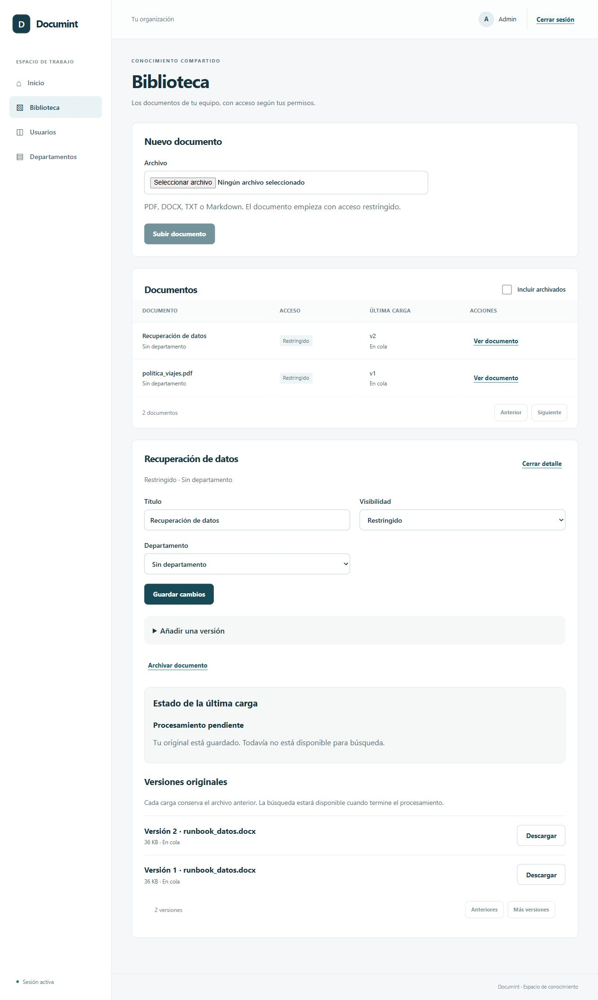

# Sesión 2C Jobs persistidos y cola Celery

## Entregable

Migración 0006 con job único por versión/pipeline, estados, stage, tiempos, error_code y
contadores separados. El upload confirma original y job en la misma transacción PostgreSQL.
Reconciliar una reserva completa también crea su job. Se migraron los originales UPLOADED
anteriores. La outbox soporta caída del broker, backoff y reintentos limitados sin duplicar IDs.

API paginada de jobs, enqueue idempotente y retry autorizado por documento. Celery recibe solo
el UUID y consume una cola separada. El worker real deja WAITING_PIPELINE/versión QUEUED, con
cero intentos de procesamiento. La web muestra ese estado sin ofrecer búsqueda ni retry en bucle.
Contrato y operación en [ADR 0008](../adr/0008-processing-outbox.md).

## Evidencia

Verificado el 16 de octubre de 2026:

- Migración 0006 aplicada y `alembic check` sin drift.
- **122 pruebas Python PASS**, con servicios reales, sin omisiones; **20 pruebas web PASS**.
  Ruff/formato, mypy estricto (75 archivos), lint/tipos/build web y formato del repositorio: PASS.
- Ocho uploads del corpus crean exactamente un job cada uno. Rollback de confirmación deja
  una reserva recuperable; las cargas inválidas no crean versiones ni jobs.
- Enqueue duplicado conserva UUID; constraints también impiden duplicados directamente en SQL.
  GET/enqueue/retry rechazan IDs ajenos. `simulate_ready` en el cuerpo devuelve 422.
- Cinco fallos de publicación simulados verifican backoff, sanitización y DISPATCH_FAILED.
  Retry conserva el UUID y no reinicia intentos de procesamiento agotados.
- Redis + Celery + PostgreSQL reales: publicación por outbox, ejecución y entrega duplicada
  terminan WAITING_PIPELINE, attempts=0 y versión QUEUED. La prueba usa su propia cola UUID,
  metadatos sintéticos confirmados y limpieza precisa; no afirma probar extracción o S3.
- El único READY simulado se prepara en un esquema transaccional `test_*` y se revierte.
- Operación local real: tres jobs de la demo despachados y consumidos. API HTTP devuelve
  WAITING_PIPELINE, attempts=0, dispatch_attempts=1. Navegador muestra “Procesamiento pendiente”
  y “Todavía no está disponible para búsqueda”.

## Límites y siguiente sesión

El runner de extracción/indexación aún no existe. No se simula procesamiento sobre documentos
reales ni se consumen intentos por esa ausencia. El dispatcher y el worker son procesos separados
durante desarrollo; su empaquetado corresponde a fase 8. La revisión de concurrencia, aislamiento
y fallos de biblioteca/cola se realiza en 2R antes de conectar el pipeline de fase 3.
